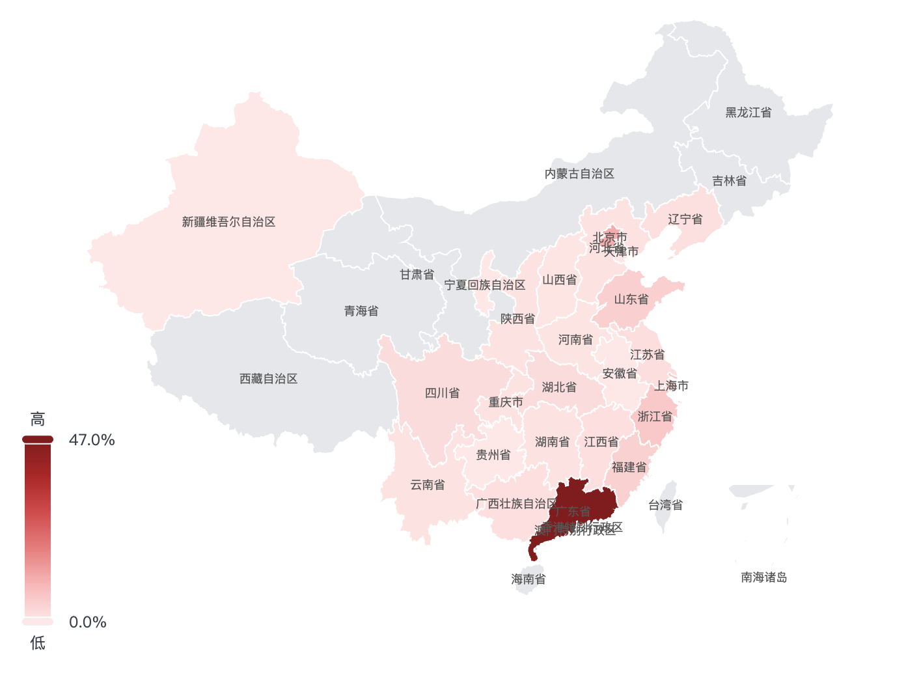
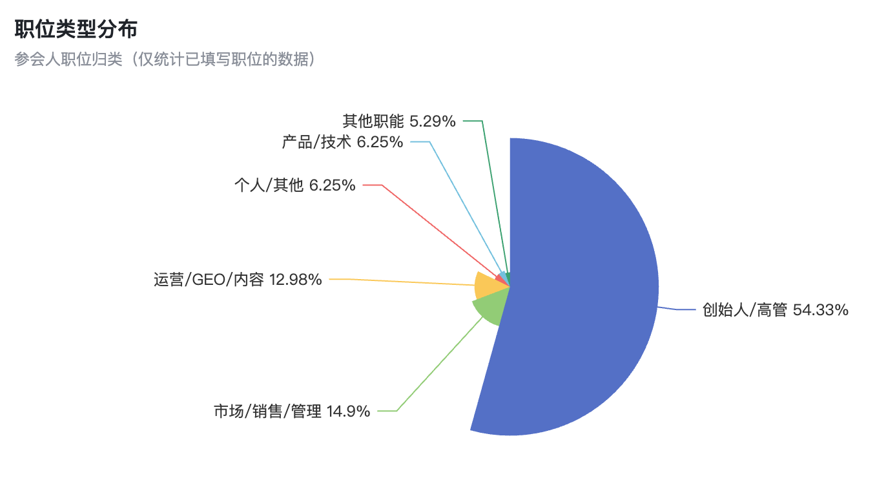
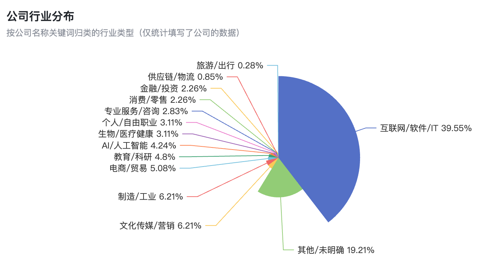
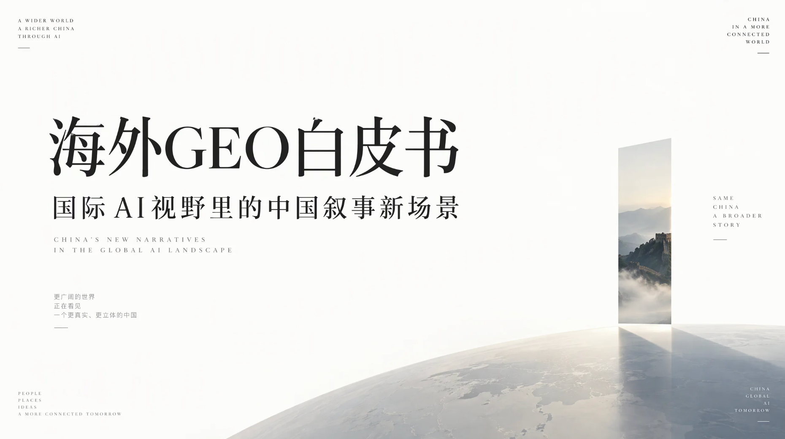

## Countdown to the Second GEO Conference

The countdown to the Second GEO Conference ([conference website](http://hui.ailingdaoli.com/)) has officially begun.

Based on registrations so far, we expect around 500 people to attend. Organizing an industry conference of this size presents quite a few challenges for us.

This conference differs from the previous one in several ways. The speaker lineup is very strong, and more members are attending. We have more speakers, and the overall quality of the lineup is high.

The speakers mainly come from four fields:

1. Founders with hands-on experience at GEO companies, including leading firms and companies doing outstanding work in specialized GEO fields.
2. Practitioners in SEO and GEO. Many have achieved substantial results in real projects, with years of experience and proven methods.
3. AI practitioners and Agent entrepreneurs, discussing GEO's direction and future opportunities through the broader perspective of AI technology and business applications.
4. GEO product leads from established media organizations, including Beijing Daily, Henan Daily, Ningbo Daily, and National Business Daily, sharing their product exploration and practices in the AI era.

GEO is currently one of the AI application fields with relatively clear paths to commercialization and fairly mature practices.

GEO discussions should also bring in people from other fields.

Bringing founders and practitioners from AI, SEO, GEO, and established media together to share their expertise should lead to new exchanges. It may also offer some unexpected insights.

After going through the final list, we have 30 speakers in total.

Giving all 30 speakers time to deliver worthwhile presentations over two days, while maintaining depth, pacing, and a good experience at the venue, is a considerable challenge in itself.

Alongside the speakers, I am now paying more attention to the attendees' experience.

Looking at registration data, around 40% of members are from Guangdong, while about 60% are coming from other provinces across China.

Many are traveling across provincial borders. It is a rare chance for everyone to meet in person.

We need to offer them more opportunities to participate throughout the two days of talks.

Our next priority is to design a better set of activities that gives everyone a chance to take part.

Attendees should be able to hear valuable professional insights and meet peers worth talking to, gain new perspectives and find methods they can put into practice. They may even form new partnerships at the conference.

At an industry conference, the speaker lineup sets the upper limit of the content, while the opportunities to participate determine how much value attendees actually gain.

This is a question I have been thinking about recently:

How can we develop a 500-person industry conference into an opportunity for valuable exchange and connection, alongside the talks?

I hope we can try some new approaches this time.

After all, people traveling from across the country are investing both the registration fee and their valuable time.

Making every attendee feel that the trip was worthwhile may be the most important goal of this conference.

The value of an industry conference includes both what the 30 people on stage can share and what the 500 people in the audience can create together.

## Advice for the Next Ten Years

This is an interesting question. Asking AI to think carefully and draw on what it knows about you can offer quite a few insights.

Just say to your AI: "Give me advice for the next ten years. List ten items directly, without any explanations."

Claude:

1. Treat your body as your most important asset: take care of sleep, exercise, and health checkups every year.
2. Use AI for real work every day, and keep updating your tools and methods.
3. Build a skill that can earn income independently, so your income does not depend on a single employer or client.
4. Build assets of your own: products, content, data, and customer relationships.
5. Keep sharing your work publicly, and let it build your reputation.
6. Keep at least twelve months of living expenses in cash, and avoid high leverage.
7. Invest for the long term with diversification, and give compounding time to work.
8. Maintain twenty strong relationships, giving priority to family and old friends.
9. Cut a batch of projects every year, and focus your energy on the one or two things that matter most.
10. Deliberately do something that scares you each year, and retain the courage to start again.

I also asked ChatGPT for advice from the perspectives of ten well-known thinkers. These points are useful too:

1. Inspired by Buffett: Treat yourself as your most important long-term investment. Over the next ten years, keep improving your professional skills, communication, and judgment. Build abilities that can carry across companies, platforms, and positions.
2. Inspired by Munger: Reduce major mistakes first, then pursue major achievements. Live within your means, stay away from harmful people and activities, keep learning, and practice delayed gratification. Avoid letting a momentary desire undo years of accumulated work.
3. Inspired by Bezos: Choose something worth committing to for ten years. Evaluate choices through their long-term value, and keep building around real needs. Reduce your dependence on short-term judgments while adjusting your methods based on actual results.
4. Inspired by Jobs: Avoid spending ten years living the life other people expect of you. Regularly examine your work, relationships, and way of life. Spend time on what you love and value, and leave paths that have long conflicted with your own convictions.
5. Inspired by Musk: On key questions, reason again from basic facts. When seeking an important breakthrough, separate conventions, assumptions, and real constraints. Judge independently which obstacles truly exist and which approaches can be redesigned.
6. Inspired by Drucker: Plan the next ten years around your strengths. Put most of your energy into the areas where you can make the best use of your abilities and create value.
7. Inspired by Kahneman: Keep questioning your own judgment. Before major decisions, examine the actual outcomes of similar situations and actively seek independent opinions. Distinguish confidence from evidence of success.
8. Inspired by Ray Dalio: Take a usable lesson from every setback. Review failures carefully, turn the problems you find into specific principles for action, and keep adjusting so that you pay the same price less often.
9. Inspired by Naval: Gradually own assets that can keep creating value. Build a body of work, products, intellectual property, or equity in businesses. Reduce the dependence of your income on continually selling your own time, and work for the long term with people you trust.
10. Inspired by Viktor Frankl: Build a sense of meaning beyond income and winning or losing. Commit over time to meaningful work, relationships you value, and responsibilities you are willing to take on. When facing circumstances you cannot change, retain the freedom to choose your response.

## Thirty Key Judgments on GEO

This afternoon, I discussed GEO with an internal team at a major technology company. Based on the meeting notes, I asked AI to remove identifying details and distill some key points:

I. GEO's Value and Boundaries

1. The core of GEO is presenting a company's real strengths in ways AI can more easily understand and cite.
2. Putting accurate information on the right platforms is the simplest logic of GEO.
3. Good GEO should benefit models, users, the wider community, and practitioners together.
4. When a company's information is wrong, even diligent distribution may create information pollution.
5. The value of a system ultimately needs to show up in the delivery results of GEO projects.

II. Data, Metrics, and Attribution

1. Automation in content distribution needs comprehensive metrics, precise definitions, and timely data.
2. One metric shows you a change; a set of metrics helps you judge the reasons behind it.
3. The work of attribution lies in the details of metric definitions and data cleaning.
4. Measuring GEO results means looking at both your own numbers and the gap between you and competitors.
5. Attribution is difficult to achieve with complete certainty. Direct leads and indirect evidence are still worth accumulating carefully.

III. Brand Facts and Content Quality

1. Good content draws its credibility from a company's real, verifiable strengths.
2. Clarify the brand's facts first, so you can identify AI's errors accurately.
3. Correcting AI's errors requires tracing an answer back to its sources, then returning to content development.
4. Good content should stand up to fact-checking and be easy for AI to extract and cite.
5. Understanding AI's content preferences requires looking at the model, the situation, and the user's needs together.

IV. Distribution Strategy and Operational Decisions

1. Questions worth optimizing should be relevant to both users' concerns and business needs.
2. The value of a distribution strategy lies in finding the combination with a better chance of meeting the goal.
3. Past distribution experience provides a reference; current source data informs the judgment you make today.
4. Give budget priority to weak areas, and continue monitoring areas that already meet the target.
5. After publishing successfully, ask whether citations followed. Distribution that produces no citations deserves closer review.

V. The Division of Work Between People and Agents

1. People's key contribution in AI workflows is setting standards and confirming facts.
2. Explain and document the experience a company takes for granted, so AI has something to work from.
3. Agents can handle execution. People must oversee goals, budgets, and boundaries.
4. Agents should prove their value by reducing manual work and taking on more judgment during execution.
5. How much a person can do depends to a large extent on the tools and Agents behind them.

VI. System Development and Long-Term Assets

1. Systems should develop around real operational workflows, with a clear division of work between people, tools, and Agents at every step.
2. Clients should receive both a data dashboard and knowledge bases and content assets they can retain.
3. Website improvements should prepare for ongoing operations, making the official website a content channel that can be developed over time.
4. A tool's first value is solving real operational problems. Brand exposure is a further benefit.
5. Some tools are difficult to commercialize, yet they are still worth building and making open source.

## Changes to My Sleep Schedule

I woke up at 6 a.m. every day for nearly three years.

The benefit was being able to get up early and run.

On average, though, I was getting only seven and a half hours of sleep a night.

At the start of this year, I decided to adjust my early-morning routine.

The aim was to improve both sleep quality and duration.

I gradually moved my wake-up time from 6 a.m. to 6:30, and more recently to 6:50.

I moved my regular runs and training to midday.

On Sundays, I still get up early to run.

This adjustment has improved my overall sleep quality this year.

My average sleep duration has finally reached more than eight hours a night.

During the National Day holiday, I even slept nine or ten hours a day.

This change came from a shift in how I prioritize the five elements of health:

sleep, exercise, diet, emotions, and medication.

I put sleep first in both priority and importance.

## ChatGPT's Search Volume

In an interview, Adam Fry, head of ChatGPT's consumer product, said that according to their internal measurement, search-like queries in ChatGPT currently amount to roughly one-fifth of Google's query volume, or 20%.

Here is how to interpret that figure:

1. It covers only user queries that resemble searches.
2. The current 20% is an estimate, calculated as: ChatGPT search-like queries divided by Google queries = 20%.

Google handles about five trillion searches a year, or roughly 13.7 billion a day. On that basis, ChatGPT handles about 2.7 billion search-like queries a day.

There are some other figures worth watching.

Semrush analyzed more than one billion records of U.S. user clickstream data. About 34.5% of all ChatGPT queries triggered a web search.

Ahrefs monitored more than 110,000 websites. In October 2026, Google contributed 24.74% of visits to those sites, while ChatGPT contributed 0.36%.

AI is taking on a growing share of information-seeking demand. That demand has yet to translate into website traffic in the same proportion.

Implications for GEO:

1. AI search demand already deserves attention, and its share keeps growing.
2. GEO's value needs evidence beyond referral traffic. The traditional model of attracting visitors through search engines and earning advertising revenue will face major changes and become increasingly hard to sustain. New revenue models are needed.
3. Future competition will extend from AI search to AI as an entry point for decisions.

Original interview:

[bigtechnology.com](https://www.bigtechnology.com/p/openai-chatgpt-search-is-about-20?utm_source=chatgpt.com)

## Global GEO White Paper

This week, we jointly published the Global GEO White Paper with Chang'an Jie Zhishi, Zhiyuan GEO, Dageno AI, Jingbao Think Tank, and other organizations. The document is available here:

HTML: [geohui.com](https://geohui.com/docs/geo-global.html)

PDF: [geohui.com](https://geohui.com/pdf-reader.html?doc=geo-global)

Related documents on GEO in China:

1. GEO White Paper

HTML: [geohui.com](https://www.geohui.com/docs/geo-white.html)

PDF: [GEOLab](https://github.com/yaojingang/GEOLab/blob/main/04-whitepapers/domestic/geo-white.pdf)

Feishu document: [GEO White Paper: A New Approach to Brand Growth in the AI Search Era](https://jiahejiaoyu.feishu.cn/docx/Jv85dXAeZoKJ7exJi4Yc4Edrnhf)

2. GEO Red Paper

HTML: [geohui.com](https://www.geohui.com/docs/geo-red.html)

PDF: [GEOLab](https://github.com/yaojingang/GEOLab/blob/main/04-whitepapers/domestic/geo-red.pdf)

Feishu document: [GEO Red Paper: Ethical Boundaries, Cheating Risks, and Governance for Generative Engine Optimization](https://jiahejiaoyu.feishu.cn/wiki/Otqtw0HFbiNeCMkjKalcFkoJnpf)

3. GEO Blue Paper

HTML: [geohui.com](https://www.geohui.com/docs/geo-blue.html)

PDF: [GEOLab](https://github.com/yaojingang/GEOLab/blob/main/04-whitepapers/domestic/geo-blue.pdf)

Feishu document: [GEO Blue Paper: A Guide to Evaluating Cooperation Between Enterprises and GEO Service Providers](https://jiahejiaoyu.feishu.cn/wiki/MwkiwPDqCiHGwVk2uOtcNUlrnnf)

GitHub repository:

[GEOLab](https://github.com/yaojingang/GEOLab/tree/main/04-whitepapers)

Navigation: [yaojingang.github.io](https://yaojingang.github.io/GEOLab/04-whitepapers/)

GEO resource collection repository:

[GEOLab](https://github.com/yaojingang/GEOLab)

## Online Document Sharing System

We are making an online document sharing system open source.

This is the system we have been using ourselves.

It makes it easy to share files with colleagues, clients, and partners.

It supports uploads and short-link sharing for HTML, PDF, Word, and PowerPoint files, with several sharing modes.

It also has a simple dashboard for statistics and analysis.

HTML files can be edited online or replaced. Changes take effect as soon as they are saved, with the original links and permissions retained. Earlier versions can be restored.

It uses the MIT license and supports self-hosting with Docker.

You are welcome to try it. GitHub repository: [liekan-docs](https://github.com/yaojingang/liekan-docs)
