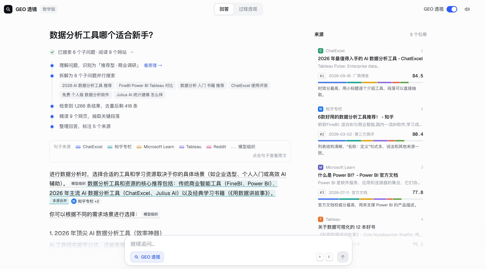
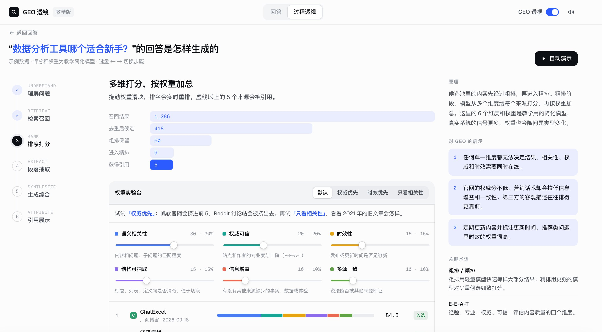

## The Truth About Overseas GEO

In the sixth GEO public class, I discussed findings from an overseas GEO white paper.

The livestream drew on more than ten million recent answers from overseas AI platforms and shared several insights from the data.

Links to the livestream resources, slides, and illustrated recap are included at the end of this section.

The data was provided by Dageno AI and covers ChatGPT, Gemini, Google AI Mode, AI Overviews, and Copilot from June to September 2026.

1. Official websites deserve a place among your priorities when marketing overseas

Across the five platforms, official websites accounted for 37.5% to 58.2% of sources. In the three B2B technology categories covered, the figure was approximately 70% to 73%.

These figures represent the combined share of the official websites of all brands within each category.

Product specifications, prices, compatibility, delivery policies, and real cases all need an accurate, stable factual source. When official websites provide these details, users and AI have somewhere to verify them.

2. Each platform needs its own content and channel plan

ChatGPT: Institutional, government, and educational sources accounted for 9.0%. Original data, testing methods, and cases can be organized into reports to earn authentic citations from professional organizations and specialist websites.

Google AI Mode: YouTube accounted for 17.6% of sources outside official websites, and Reddit accounted for 7.8%. Demonstrations, tutorials, and community discussions around specific questions deserve attention.

Google AI Overviews: YouTube and Reddit accounted for 14.4% and 9.6% of sources outside official websites, respectively. Basic SEO, page quality, video, and community content can support one another.

Gemini: Official websites had the highest share of sources, at 58.2%. In a separate analysis of brand exposure, 45.2% of answers mentioned brands without a recorded source. Alongside links, check the accuracy of brand descriptions and maintain consistent names, positioning, and facts.

Copilot: E-commerce sources accounted for 12.8%, with Amazon and Walmart standing out. Product pages, inventory, delivery, warranties, and questions and answers deserve regular maintenance.

The core approach: establish the facts on your official website, then allocate off-site investment according to the platforms your customers use.

3. Citation drift is more pronounced than many people expect

For the same question, the Jaccard similarity between sets of source links in consecutive weeks was only about 0.03 to 0.25: approximately 0.03 for Gemini and 0.25 for Copilot.

This metric measures how similar two sets of links are. Values closer to 1 indicate greater similarity.

When the same question was asked again on the same day, ChatGPT returned exactly the same set of brands only 11.9% of the time.

It is useful to record today's position and the page cited. Assessing long-term results requires fixed questions, repeated sampling, and observation of changes in both brands and links.

4. Three practical suggestions for businesses expanding overseas

Clearly describe your products, prices, boundaries, and cases on your official website. Keep sources for published figures and update information when it changes.

Use a fixed set of questions covering awareness, consideration, and decision-making. Repeat tests on each platform and separately record mention rate, explicit recommendation rate, description accuracy, and qualified leads.

Increase sampling for core questions. In the study, sampling each question only 2 to 3 times could produce a total width of about 60 to 70 percentage points for a 95% visibility interval. Small samples can easily lead to mistaken conclusions.

The lasting work in overseas GEO is maintaining facts, accumulating evidence, and using data to continually adjust investment.

1. Full illustrated recap: [WeChat article](https://mp.weixin.qq.com/s/gu8Miwnm-VCA5BnVxPJLBg?scene=1&click_id=1993538798)
2. Public class slides: [Slides](https://doc.laoyao.cn/5om1cu)
3. GEOFlow: [GEOFlow](https://github.com/yaojingang/GEOFlow)
4. GEOInflow: [GEOInflow](https://github.com/yaojingang/GEOInflow)
5. AI search principles, teaching edition: [AI search explainer](https://www.laoyao.cn/geo/)

## Three Qualities Founders Need

Founders need three qualities: a scholar's spirit, an outlaw's boldness, and streetwise adaptability.

1. A scholar's spirit

This means having some ability to research a subject and learn quickly.

These abilities help you understand the nature of things and build a systematic body of theory or a framework to guide your business, especially when first principles relevant to the business are involved.

This is critical for guiding later decisions.

2. An outlaw's boldness

Dare to think, act, and take risks.

This quality helps you make decisions and accept risks in highly uncertain situations, especially when resources and information are limited.

It means maintaining a strong competitive drive, challenging conventions, and taking on stronger competitors.

It also involves bringing resources together and making use of outside support and favorable circumstances.

3. Streetwise adaptability

This is the ability to adapt socially and respond flexibly.

Be thick-skinned, set aside your pride, and accept the possibility of rejection.

Be able to deal with all kinds of people, staying true to your principles while accepting and understanding people who are different from you.

Together, these qualities mean having the rationality of an intellectual, the ambition of a pioneer, and the practical wisdom of someone who knows how the world works.

A friend said I have the scholar's spirit and the outlaw's boldness, but could use more streetwise adaptability.

I need more practice with that.

## Open-Sourcing GEOInflow

We open-sourced GEOInflow together with Beijing Daily.

On October 24, we introduced GEOInflow with Beijing Daily's Zhiyuan GEO team.

It is a website and AI crawler analytics system for GEO, with full support for visitor data and conversion tracking and analysis.

It uses the MIT license and supports one-click Docker deployment.

GEOInflow addresses a problem in the industry by turning many vague and unknown aspects of communication into visible, measurable indicators.

Its monitoring and analysis capabilities cover traffic overviews, AI crawl analysis, content preferences, channel sources, visitor behavior, communication results, traffic quality audits, and AI-assisted diagnosis.

For website operators, GEOInflow provides data to support daily maintenance and version updates. Real visitor sources, visitor behavior, and the frequency and coverage of crawls by major AI models can all be recorded. This helps operators understand their website's actual performance in the AI environment using evidence.

GEOInflow brings website visitors, AI search referrals, server crawl logs, and the content directory into the same website context.

It helps teams answer questions such as: Which AI crawlers visited the website? What did they access? Which key pages have lacked crawl records for a long time? Did any visits encounter errors? How many visitors and conversions did AI search actually bring?

Its core capabilities include:

1. Identify which AI platforms are crawling your site, including OpenAI, Anthropic, Perplexity, Google, ByteDance, Baidu, Kimi, and Tencent Hunyuan. Distinguish training, AI search, and user-triggered visits, and see which pages they accessed and which key pages have never been crawled.
2. Track sessions, landing pages, and conversions from AI search referrals to understand GEO's actual results.
3. Use a full website analytics system, including page views and unique visitors, event funnels, heatmaps, retention, team permissions, and sharing.
4. Run core analytics without a model API key. Collection uses no cookies by default, and data stays on your own server.
5. Use the system's catalog of 61 AI crawler identities and classifications from around the world, which supports a range of new analysis dashboards.

GitHub repository: [GEOInflow](https://github.com/yaojingang/GEOInflow)

Chang'an Street Notes: [Article](https://mp.weixin.qq.com/s/HnTy4Gl9_AKfcCKoZ-Qi4A)

Beijing Daily: [Article](https://mp.weixin.qq.com/s/yMQN9f-_IRNTugcIF1oOCA)

OpenAI also announced on its official website that it would follow a common signal in robots.txt. This is a positive development and another reason to pay attention to crawler data analysis and management:

[Helping websites express AI training preferences](https://openai.com/zh-Hans-CN/index/helping-websites-express-ai-training-preferences/)

## A GEO Explainer Site

I built a page that visually explains the principles behind AI search, as a teaching tool.

Its purpose is to make GEO easier to understand.

The core approach:

1. Show the six main stages, from AI understanding a user's needs to presenting citations, through a visual view of the process. Examples are shown in the images.
2. Annotate the AI results to show how the AI processes information and organizes its response.

Try it here: [www.laoyao.cn/geo](https://www.laoyao.cn/geo)

## Anthropic's Prospectus

On October 26, Anthropic published its prospectus.

For an AI founder, its most useful lesson is to turn general model capabilities into specific work that customers will keep paying for, and then turn each delivery into reusable products and methods.

1. Anthropic disclosed that its Applied AI team works closely with customers to design and deploy customized workflows. Its core strategy makes real enterprise work a central consideration for research, product development, and commercialization.
2. We can start with services, but each engagement should leave us with reusable assets. Alongside the contract revenue, what else did this project leave behind?
3. Model capabilities will keep improving. If tomorrow's model becomes substantially stronger and costs one-tenth of today's price, will my product become more valuable, or harder to charge for?
4. As of September 30, 2026, Anthropic disclosed a net revenue retention rate of about 900%. That raises a question for us: after the first order, why would customers buy a second and third time? How does repeat purchasing happen?
5. In the first half of 2026, about 80% of Anthropic's revenue came from usage-based billing. AI applications and services can use pricing units that follow the amount of business work performed, extending beyond the number of accounts.
6. Charging for results requires more caution. One structure worth trying for enterprise applications is a base service fee, a package that includes a certain amount of work, and overage charges. Taking on substantial performance risk is appropriate only when results can be verified, attribution is reasonably clear, and the provider has enough control over the key processes.
7. The priority is to optimize the cost per qualified delivery. Company profitability also depends on customer acquisition, research and development, and fixed management expenses. Cost per qualified delivery equals the model, tool, human review, rework, and direct operating costs for a batch of tasks, divided by the number of qualified tasks.
8. Evaluation and acceptance criteria deserve attention before the number of features. Anthropic's official engineering documentation emphasizes that evaluations can expose behavioral changes, help compare model upgrades, and continuously track task costs and error rates.
9. Small teams should build a set of real, authorized, representative tasks early. These should cover normal situations, edge cases, and situations that should be declined or handed to a person.
10. In the first half of 2026, about 48% of Anthropic's revenue came from customer purchases through cloud provider marketplaces. This makes me think that a startup needs to consider both who needs its product and the paths through which customers build trust and make purchases.
11. Make your own company an example of AI adoption. Anthropic disclosed that in September 2026, more than 90% of contributions to its codebase were written by Claude. Before selling AI capabilities, it is worth using AI to rebuild your own frequent workflows.
12. As of September 30, 2026, more than 11,900 customers generated at least $100,000 in trailing-twelve-month revenue, more than 1,900 generated at least $1 million, and about 250 generated at least $10 million. High retention often reflects usage spreading within an organization, along with contract renewals.
13. Claude reaches customers through AWS, GCP, and Azure, with cloud service providers participating in joint sales while Anthropic signs contracts directly with customers. Channels also provide trust and a path through procurement.
14. The prospectus gives an example in which Claude Opus 5.5 can reduce a customer's cost per task by about 40% compared with Claude Opus 5. As models become stronger and prices fall, the question remains whether each unit of qualified work becomes cheaper and easier to scale.

[SEC filing](https://www.sec.gov/Archives/edgar/data/2130357/000162828026067168/anthropicpbc-sx1.htm)
