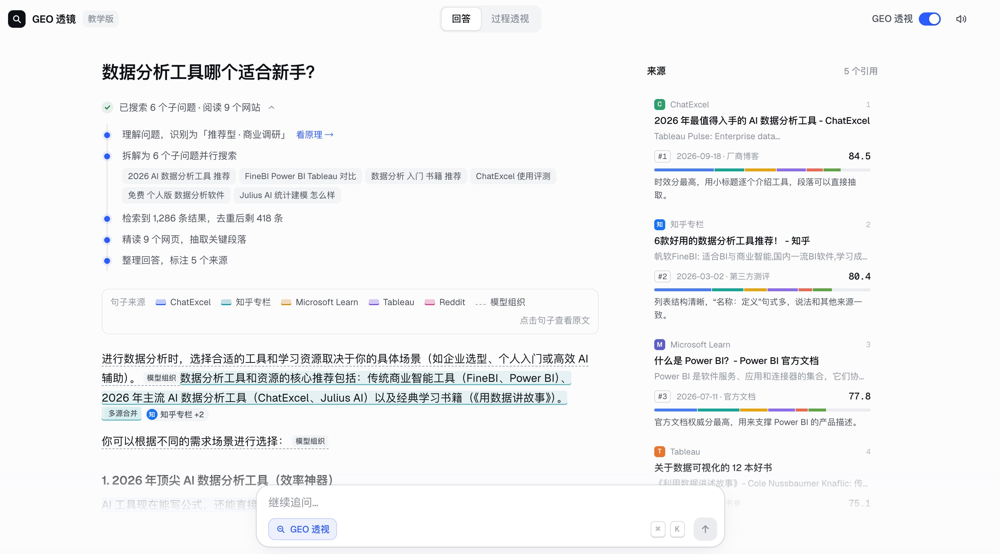
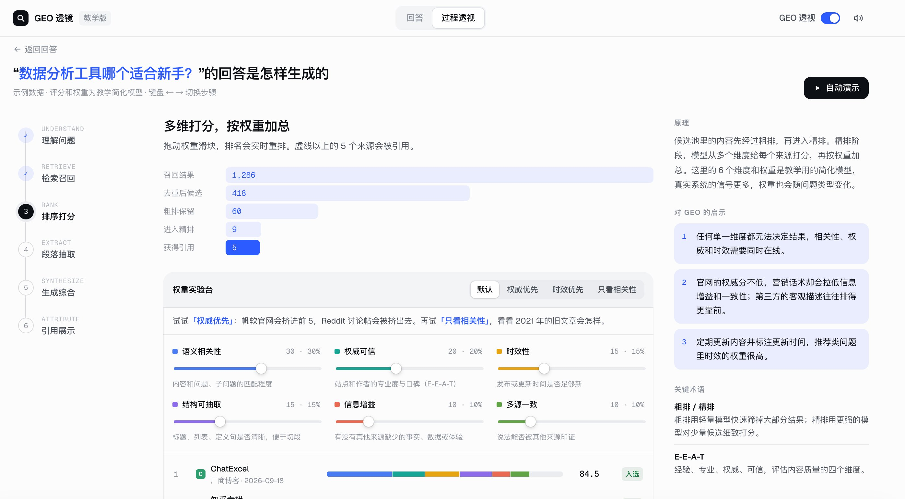
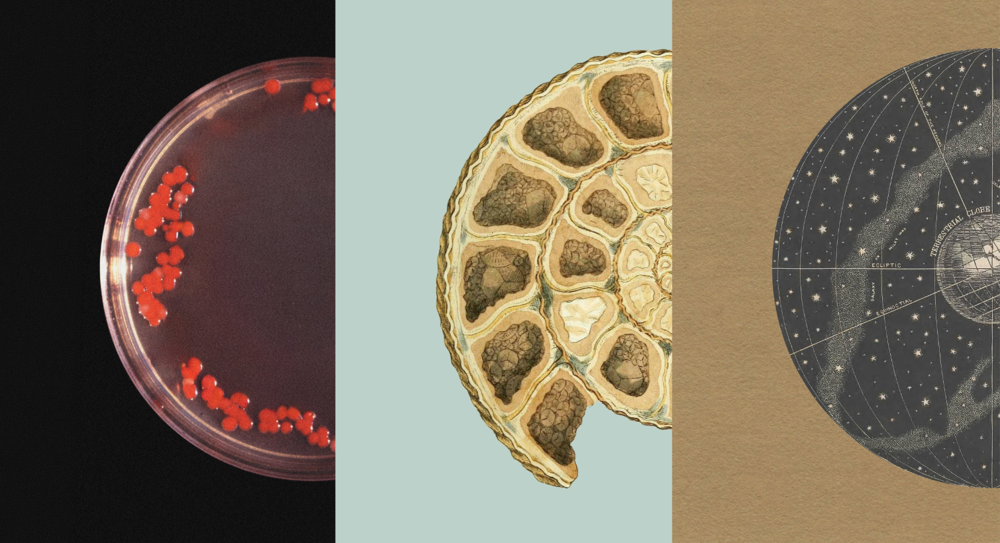

## 海外GEO的真相

第六场GEO公开课，讲了海外GEO白皮书的一些内容

直播基于1000多万条最新的海外各AI平台的回答数据，分享了几点数据洞察

直播相关资源、PPT及图文总结复盘链接，已附在了文末

数据由Dageno AI提供，覆盖2026 年 6 月至 9 月的 ChatGPT、Gemini、Google AI Mode、AI Overviews 和 Copilot

1. 官网，值得放进出海营销的优先级

五个平台的官网来源占比达到 37.5% 至 58.2%。在覆盖的三个 B2B 技术品类里，这个比例约为 70% 至 73%

这里统计的是品类内各品牌官网的合计份额

产品参数、价格、兼容范围、交付政策、真实案例，都需要一个准确、稳定的事实出处。官网把这些内容补齐，用户和 AI 才有地方核对

2. 五个平台，需要分别安排内容和渠道

ChatGPT：机构、政府与教育类来源占 9.0%。可以把原创数据、实测方法和案例整理成报告，争取专业机构与垂直网站的真实引用

Google AI Mode：YouTube 占非官网来源的 17.6%，Reddit 占 7.8%，值得围绕具体问题做演示、教程和社区交流

Google AI Overviews：YouTube、Reddit 分别占非官网来源的 14.4%、9.6%，基础 SEO、页面质量、视频与社区内容，可以协同推进

Gemini：官网来源占比最高，为 58.2%；另一项品牌露出分析中，45.2%的回答提到品牌却未记录来源，除了链接，还要看品牌描述是否准确，维护一致的名称、定位与事实

Copilot：电商来源占 12.8%，Amazon、Walmart 表现突出，商品页、库存、配送、保修和问答，值得持续维护

核心逻辑：先把官网事实做好，再按客户常用的平台分配站外投入

3. 引用漂移，比很多人想象中明显

同一个问题，相邻两周的来源链接集合，Jaccard 相似度只有约 0.03 至 0.25：Gemini 约 0.03，Copilot 约 0.25

这个指标衡量两组链接的相似程度，越接近 1 越相似

同一天重问，ChatGPT 得到完全相同品牌集合的比例，也只有 11.9%

今天出现在哪个位置、引用了哪个页面，都适合记录；判断长期效果，需要固定问题、重复采样，同时观察品牌和链接的变化

4. 给出海企业三个具体建议

把官网的产品、价格、边界和案例写清楚，公开数字保留出处，信息变化及时同步

固定一组覆盖认知、考虑、决策阶段的问题，按平台复测，分别记录提及率、明确推荐率、描述准确率和有效线索

对核心问题增加采样。研究中，每题只测 2 至 3 次，可见度的 95%区间总宽度可达约 60 至 70 个百分点，小样本很容易让人误判

海外GEO值得长期做的，是维护事实、积累证据，再用数据持续校准投入

1. 完整图文版总结：

[mp.weixin.qq.com](https://mp.weixin.qq.com/s/gu8Miwnm-VCA5BnVxPJLBg?scene=1&click_id=1993538798)

2. 公开课PPT：

[doc.laoyao.cn](https://doc.laoyao.cn/5om1cu)

3. GEOFlow：

[GEOFlow](https://github.com/yaojingang/GEOFlow)

4. GEOInflow：

[GEOInflow](https://github.com/yaojingang/GEOInflow)

5. AI搜索原理教学版：

[laoyao.cn](https://www.laoyao.cn/geo/)

## 创业者三气

创业者需要具备三个“气”

分别是书生气、匪气和痞气

1. 书生气

简单理解，就是具备一定的学术研究的能力，具备快速学习的能力

这种能力的好处，能快速洞察事物的本质，可以建立系统性的理论体系或框架，用于指导自己的业务

尤其是设计到与业务有关的第一性原理

这个对后面的决策指导性，非常关键

2. 匪气

敢想、敢干、敢冒险

这种能力，能够在高度不确定的环境下，敢于做决策以及承担风险

尤其是在资源不足以及信息不明确的时候

能够保持很强的市场进攻性，敢于突破常规，敢于挑战强者

同时，善于整合资源，借力、借势

3. 痞气

这是一种社会适应能力和灵活变通的能力

脸皮厚、放得下身段、不怕被拒绝

能够与各种各样的人打交道，保持自己正气的同时，也包容和理解各种不一样的存在

这三个“气”，背后的实质是：创业者既要有知识分子的理性，也要有开拓者的野心，还要有江湖人士的生存智慧

朋友说，我书生气和匪气都有，唯独缺乏点痞气

这个，需要多练练

## 开源GEOInflow

和北京日报社，一起开源了GEOInflow

10月24日，我们与北京日报社智源GEO一起：GEOInflow

这是一套面向GEO的网站与AI爬虫分析系统，同时支持完整的访客数据、转化数据统计与分析

MIT协议，Docker一键部署

GEOInflow的出现，直击这一行业痛点，把传播过程中诸多模糊未知的问题，转化为可查看、可量化的直观数据指标。

系统搭载完整的监测分析能力，覆盖流量总览、AI抓取分析、内容偏好研判、渠道来源解析、访客行为画像、传播效果衡量、流量质量审计、AI辅助问题定位等核心功能模块

针对网站运维人员，GEOInflow可为网站日常运维、版本迭代提供坚实的数据支撑。网站真实访客来源、用户访问行为特征、各大AI大模型爬虫对站点内容的抓取频次与覆盖范围等过去难以捕捉的细节，均可完整留存记录，帮助运营人员摆脱主观经验局限，客观掌握网站在AI生态下的真实运行状态

GEOInflow将网站访客、AI搜索引荐、服务器抓取日志和内容目录放在同一个网站上下文中

帮助团队回答这些问题：哪些 AI 蜘蛛访问了网站，访问了哪些内容，哪些关键页面长期缺少抓取记录，访问是否遇到错误，以及AI搜索实际带来了多少访客和转化

核心逻辑与能力：

1. 哪些AI平台在抓你的站（OpenAI、Anthropic、Perplexity、Google、字节、百度、Kimi、腾讯混元…），是训练、AI 搜索，还是用户触发的访问。包括，抓了哪些页面，哪些关键页从没被抓过
2. 同时可以追踪AI搜索引荐来的会话、落地页和转化，看清GEO的真实效果
3. 它也是一套完整的网站统计：PV/UV、事件漏斗、热力图、留存、团队权限与分享
4. 核心统计无需模型API Key，默认无Cookie采集，数据留在你自己的服务器上
5. 系统已整理61种全球范围内各种不同的AI爬虫身份及分类，在这个基础上构建了大量的全新数据分析看板

GitHub仓库地址：

[GEOInflow](https://github.com/yaojingang/GEOInflow)

长安街知事：

[mp.weixin.qq.com](https://mp.weixin.qq.com/s/HnTy4Gl9_AKfcCKoZ-Qi4A)

北京日报：

[mp.weixin.qq.com](https://mp.weixin.qq.com/s/yMQN9f-_IRNTugcIF1oOCA)

OpenAI也正式在官网宣布，OpenAI将遵循 robots.txt 中的一项通用信号，这也是一个很积极的信号，大家需要重视爬虫的数据分析与管理：

[openai.com](https://openai.com/zh-Hans-CN/index/helping-websites-express-ai-training-preferences/)

## GEO科普站

写了一个可以直观展示AI搜索过程原理的页面（教学版）

核心目的，方便大家更直观的理解GEO的原理

核心逻辑：

1. 把AI理解用户需求，到引用展示的6个核心环节，通过可视化的过程透视，显示出来，详见图片示例
2. 对于AI的结果，也通过透视的方式，把AI的处理过程和结果的整理逻辑，也进行了标注

体验地址：

www.laoyao.cn/geo

## Anthropic的招股书

10月26日，Anthropic发布了招股书

对普通AI创业者，这份招股书最有价值的启发，是：把通用模型能力，转化成客户愿意持续购买的具体工作，再把每次交付沉淀成可复用的产品和方法

1. Anthropic在招股书中透露，Applied AI团队会深入客户，设计和部署定制化工作流程。核心策略，是把企业真实工作场景，作为研发、产品与商业化的重要组织方向
2. 我们可以从服务开始，但每次服务都要留下资产，对创业的启发是：除了合同收入，这个项目还留下了什么？
3. 模型能力会越来越强。假设明天模型明显增强、价格降到今天的十分之一，我的产品会更有价值，还是更难收费？
4. 截至2026年9月30日，Anthropic披露的净收入留存率约为900%。我们的思考：第一笔订单完成之后，客户为什么会买第二笔、第三笔？复购是如何产生的？
5. 2026年上半年，Anthropic约80%的收入来自按量付费，AI应用或服务的收费单位，可以突破账号数量，进一步贴近业务工作量
6. 但是，按结果收费需要更谨慎，对企业应用，一个可以尝试的结构是：基础服务费＋包含一定工作量的套餐＋超额用量费。只有结果能够核验、归因相对清楚、服务商对关键过程有足够控制时，才适合承担较大的效果风险
7. 最应该优化的是“合格交付成本”，公司是否盈利，还要继续考虑获客、研发和固定管理费用。单次合格交付成本＝该批任务的模型、工具、人工复核、返工及直接运维成本÷合格任务数量
8. 评测和验收标准，值得比功能数量更早建设，Anthropic官方工程文档强调，评测能够暴露行为变化、帮助比较模型升级，并持续追踪任务成本和错误率。
9. 对小团队，建议尽早建立一批真实、经过授权的代表性任务，覆盖正常场景、边界场景，以及应该拒绝或转人工处理的场景
10. 2026年上半年，Anthropic约48%的收入来自客户通过云服务商市场购买。这个信号让我想到：创业项目除了考虑“谁需要”，还应考虑“客户通过什么路径相信并采购”
11. 先让自己的公司成为AI应用样板，Anthropic披露，2026年9月其代码库贡献中超过90%由Claude编写。也就是说，对外销售AI能力之前，值得先用AI重做自己的高频工作
12. 截至2026年9月30日，TTM收入达10万美元以上的客户超过11,900家，达100万美元以上超过1,900家，约250家达1,000万美元以上，高留存背后，往往是用量在组织内的扩散，而不只是续约一张合同
13. Claude已通过AWS、GCP、Azure三大云平台触达客户，并采取与CSP联合销售、公司与客户直接签约的结构。渠道不只是“多卖一份”，也是信任与采购路径本身
14. 招股书举例，Claude Opus 5.5相较Claude Opus 5，可将客户单任务成本降低约40%，模型更强、单价下降时，真正该问的仍是：单位合格工作是否更便宜、是否更容易扩量

[sec.gov](https://www.sec.gov/Archives/edgar/data/2130357/000162828026067168/anthropicpbc-sx1.htm)
