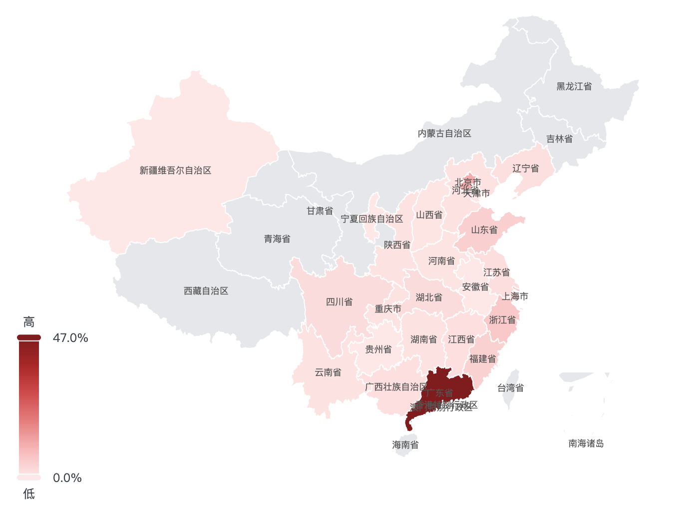
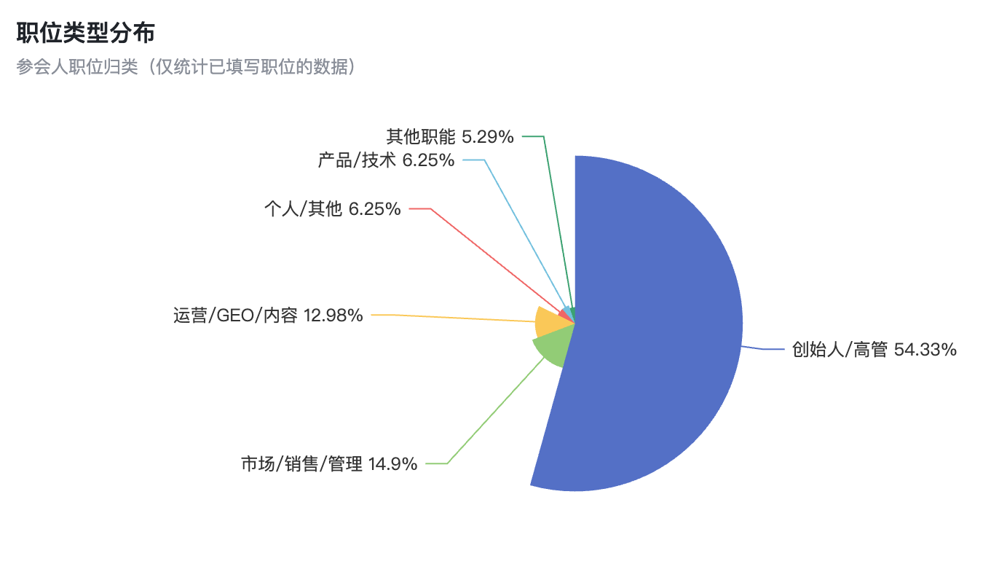
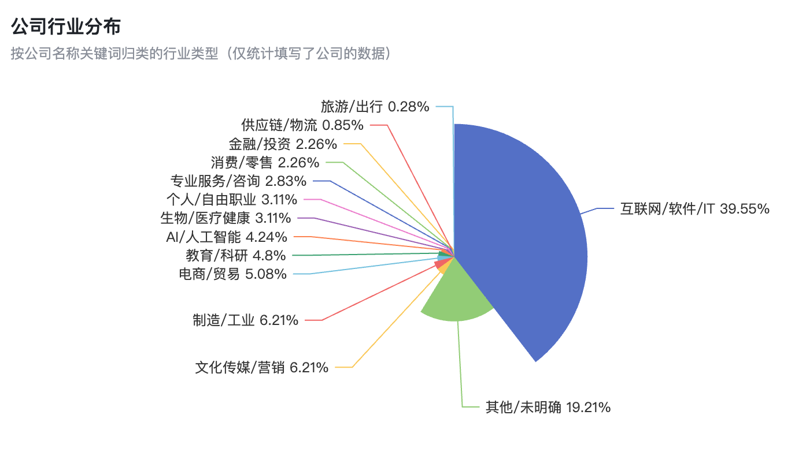
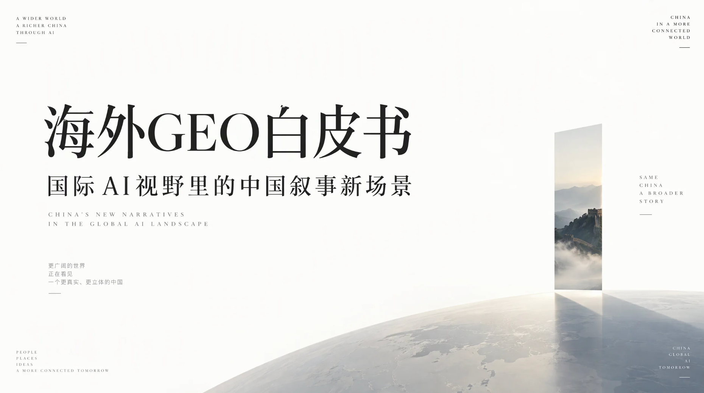

## 第二届GEO大会倒计时

正式进入第二届GEO大会（[大会官网](http://hui.ailingdaoli.com/)）的倒计时

按照目前的报名进度，预计会有500人左右参会。组织这样规模的行业大会，对我们来说，还是有不少挑战的

这届大会与上一届相比，有很多不同的地方，一是嘉宾阵容非常强大，二是参会会员更多，不仅分享嘉宾的数量多，而且整体质量也很高

嘉宾主要来自四个领域：

1. GEO公司的实战型创始人，既有行业头部机构，也有在垂直GEO领域做得非常出色的代表性公司
2. SEO+GEO领域的实战专家， 很多都在实际项目中拿到过大结果，既有长期积累，也有经过验证的方法论
3. AI领域的实战专家和Agent创业者，从更广阔的AI技术与商业应用视角，探讨GEO的发展方向和未来机会
4. 权威媒体的GEO产品负责人，包括北京日报社、河南日报社、宁波日报社、每日经济新闻等，分享媒体机构在AI时代的产品探索与实践

GEO是目前商业化路径相对清晰、实践成熟度较高的AI应用领域之一

但GEO也不应该只是GEO圈内部的交流

把AI圈、SEO圈、GEO圈，以及权威媒体的创始人和实战专家聚在一起，从不同角度展开专业分享，我觉得会产生很多新的碰撞，也可能带来一些超出预期的启发

正式梳理完嘉宾名单后，这次一共有30位分享嘉宾

要在两天时间内，让30位嘉宾有序完成高质量的分享，同时保证内容的深度、节奏和现场体验，本身就是一个不小的挑战

除了嘉宾，我现在更加关注的是参会者的体验

看了一下报名数据，广东本省的会员大概占40%，另外60%左右来自全国其他省份

很多人都是跨省赶来，大家难得有机会线下聚在一起

如果只是坐在台下听两天分享，还远远不够

接下来，我们需要重点考虑的是：如何设计一套更好的活动机制，让每个人都能真正参与进来

既能听到有价值的专业分享，也能结识值得交流的同行；既能获得新的认知，也能找到可以实际落地的方法；甚至有机会在现场建立新的合作关系

对于一场行业大会而言，嘉宾阵容决定了内容的上限，而参与机制决定了参会者实际能够获得多少价值

这也是我最近在思考的一个问题：

如何把一场500人的行业大会，从单纯的知识分享，升级为一次高质量的行业交流与连接？

希望这次能做出一些新的尝试

毕竟，大家从全国各地赶来，花费的不只是报名费，还有非常宝贵的时间

让每一位参会者都觉得不虚此行，可能才是这场大会最重要的目标

一场行业大会的价值，不仅在于台上的30个人能够分享什么，还应该思考的，在于台下的500个人能够产生什么？

## 未来10年的建议

这个问题很有意思，让AI仔细思考，并结合对你的了解，可以有不少启发。

只需要对着你的AI说：给我未来10年的建议，不要任何解释，直接列出10条

Claude：

1. 把身体当成第一资产：睡眠、运动、体检每年都要到位
2. 每天用 AI 做真实工作，持续更新自己的工具和方法
3. 打造一项能独立变现的能力，让收入不依赖单一雇主或单一客户
4. 建立属于自己的资产：产品、内容、数据、客户关系
5. 持续公开表达，让作品替你积累信誉
6. 保留至少 12 个月生活费的现金，远离高杠杆
7. 长期、分散地投资，把时间交给复利
8. 深耕 20 个高质量关系，优先陪伴家人和老朋友
9. 每年砍掉一批项目，把精力集中在最重要的一两件事上
10. 每年主动做一件让自己害怕的事，保持敢于重新开始的能力

再问了下ChatGPT，从10个名人视角触发，也很有参考价值：

1. 巴菲特的启发：把自己当成最重要的长期投资。 未来十年，持续提升专业能力、表达能力与判断力，积累不依附于某家公司、某个平台或某个职位的本领
1. 芒格的启发：先减少大错，再追求大成。 量入为出，远离有害的人与事，坚持学习和延迟满足，避免让一时的欲望破坏多年的积累
2. 贝索斯的启发：选择值得投入十年的事情。 用长期价值衡量选择，围绕真实需求持续积累；减少对短期评价的依赖，同时根据实际结果调整方法
3. 乔布斯的启发：不要用十年过别人期待的人生。 定期审视自己的工作、关系与生活方式，把时间投入真正热爱、真正重视的事情，及时离开长期违背内心的道路
4. 马斯克的启发：在关键问题上，从基本事实重新推理。 面对重要突破，拆开惯例、假设与真实限制，独立判断哪些障碍确实存在，哪些做法可以重新设计
5. 德鲁克的启发：围绕优势安排未来十年。 把主要精力投入最能发挥长处、创造价值的领域
6. 卡尼曼的启发：对自己的判断保留怀疑。 重大决定前，查看同类事情的真实结果，主动听取独立意见，不把强烈的自信当成成功的证据
7. 瑞·达利欧的启发：让每一次挫折留下可用的经验。 失败后认真复盘，把发现的问题转化为具体的行动原则，持续修正自己，减少重复付出同一种代价
8. 纳瓦尔的启发：逐步拥有能够持续创造价值的资产。 积累作品、产品、知识产权或企业权益，减少收入对持续出售个人时间的依赖，与值得信任的人长期合作
9. 维克多·弗兰克尔的启发：建立超越收入与输赢的人生意义。 长期投入有意义的工作、值得珍惜的关系与愿意承担的责任；面对无法改变的处境，保留选择回应方式的自由

## GEO的30个关键判断

下午和一家大厂内部团队分享交流GEO，根据会议纪要，让AI脱敏后提炼了一些要点总结：

一、GEO的价值与边界

1. GEO的核心，是让企业真实的优势，以AI更容易理解和引用的方式呈现出来
2. 把正确的信息，投放到正确的平台，就是GEO最朴素的逻辑
3. 真正好的GEO，应该让模型、用户、生态和从业者共同受益
4. 企业信息都错了，再勤奋的投放也可能是在制造信息污染
5. 系统的价值，最终要体现在GEO项目的交付结果上

二、数据、指标与归因

1. 指标要全、定义要准、数据要及时，自动化投放才有发挥作用的基础
2. 一个指标让你看到变化，一组指标帮助你判断变化背后的原因
3. 数据归因的功夫，藏在指标定义和数据清洗的细节里
4. 衡量GEO效果，既要看自己的数字，也要看与竞品的距离
5. 归因很难做到百分之百，直接线索和间接证据依然值得认真积累

三、品牌事实与内容质量

1. 好内容的底气，来自企业真实、可核验的优势
2. 先把品牌事实拆清楚，才能把AI的错误找准确
3. 纠正AI的错误，要从答案追溯到信源，再回到内容建设
4. 好内容要经得起事实核对，也要方便AI抽取和引用
5. 理解AI的内容偏好，要同时看模型、场景和用户诉求

四、投放策略与运营决策

1. 值得优化的问题，要同时贴近用户的关心和业务的需要
2. 投放策略的价值，是在多种组合中，找到目标达成概率更高的那一种
3. 过去的投放经验提供参照，实时的信源数据提供当下的判断依据
4. 预算优先投向薄弱环节，已经达标的部分继续监测
5. 发布成功之后，还要追问引用是否发生；没有被引用的投放，更需要复盘

五、人与Agent的分工

1. 人在AI工作流中的关键价值，是把标准立起来，把事实确认好
2. 把企业心照不宣的经验说清楚、写明白，才能让AI有据可依
3. 执行可以交给Agent，目标、预算和边界必须由人把关
4. Agent的价值，要体现在减少人工操作、承担更多执行判断上
5. 一个人能做多少事，很大程度上取决于他背后的工具和Agent能力

六、系统建设与长期资产

1. 系统应该沿着真实的运营流程生长，每个节点都要明确人、工具和Agent的分工
2. 客户拿到的成果，应该既有数据看板，也有能够留存的知识库和内容资产
3. 官网改造要为后续运营铺路，让官网成为可以持续经营的内容渠道
4. 工具的第一价值，是解决真实的运营问题；品牌扩散，是进一步的收获
5. 有些工具商业化很难，但它们依然值得被做出来，也值得被开源

## 睡眠作息改变

每天6点准时起床，持续了近3年

6点起床的好处，是可以早起跑步

但平均下来，每天的睡眠时间只有七个半小时

在年初时

决定调整早起的节奏

目的是为了增加提升睡眠质量和时长

于是，慢慢把自己的起床时间，从早上6点，调整到6点30，再到最近的6点50

日常跑步和训练，就改成了中午

周日正常早起跑

这个调整，让今年整体的睡眠质量好了不少

平均每天的睡眠时长，终于到了8小时+

甚至国庆节期间，每天睡眠能到9小时甚至10小时

这个变化的底层逻辑

是对于健康五要素的排序发生了变化

睡眠、运动、饮食、情绪、用药

睡眠的优先级与重要性，放在了第一位

## ChatGPT的搜索量

ChatGPT消费者产品负责人Adam Fry，在采访时透露，按照他们内部统计口径：ChatGPT中类似搜索的查询量，目前大约相当于Google查询量的五分之一，也就是20%

理解这个结论的逻辑：

1. 这里的搜索查询量，仅仅是类似搜索的用户查询，不是ChatGPT的全部Prompt
2. 目前的20%，也仅仅是估算值，对应的数值计算逻辑是：ChatGPT搜索类查询量 ➗ Google查询量 = 20%

Google的全年搜索量约为5万亿次，平均到每天大概137亿次，这样算下来，ChatGPT每天的类似搜索的查询量大约27亿次

另外，还有一组值得关注的数据

Semrush分析了超过10亿条美国用户点击流数据，ChatGPT的所有查询量里，大约34.5%的查询触发联网搜索

而Ahrefs对超过11万个网站的监测显示，2026年10月，Google贡献了这些网站24.74%的访问量，而ChatGPT只贡献了0.36%

AI正在承接越来越多的信息获取需求，但这些需求，并没有按相同比例转化为网站的访问流量

对GEO的启示

1. AI搜索需求已经不能忽视，且占比越来越大
2. GEO的价值不应只通过引荐流量证明，传统网站靠搜索引擎引流，再加上广告盈利的方式，接下来会面临大的变革，越来越不可持续，需要构建新的盈利模式
3. 未来的竞争不仅是AI搜索，更是AI决策入口

原始采访：

[bigtechnology.com](https://www.bigtechnology.com/p/openai-chatgpt-search-is-about-20?utm_source=chatgpt.com)

## 海外GEO白皮书

本周和长安街知事、智源GEO、Dageno AI、京报智库等机构一起，联合发布了《海外GEO白皮书》，对应的文档地址

HTML：[geohui.com](https://geohui.com/docs/geo-global.html)

PDF：[geohui.com](https://geohui.com/pdf-reader.html?doc=geo-global)

国内相关文档

1. 《GEO白皮书》

HTML：[geohui.com](https://www.geohui.com/docs/geo-white.html)

PDF：[GEOLab](https://github.com/yaojingang/GEOLab/blob/main/04-whitepapers/domestic/geo-white.pdf)

飞书文档：[《GEO白皮书：AI搜索时代的品牌增长新范式》](https://jiahejiaoyu.feishu.cn/docx/Jv85dXAeZoKJ7exJi4Yc4Edrnhf)

2. 《GEO红皮书》

HTML：[geohui.com](https://www.geohui.com/docs/geo-red.html)

PDF：[GEOLab](https://github.com/yaojingang/GEOLab/blob/main/04-whitepapers/domestic/geo-red.pdf)

飞书文档：[《GEO红皮书：生成式引擎优化的伦理边界、作弊风险与治理手册》](https://jiahejiaoyu.feishu.cn/wiki/Otqtw0HFbiNeCMkjKalcFkoJnpf)

3. 《GEO蓝皮书》

HTML：[geohui.com](https://www.geohui.com/docs/geo-blue.html)

PDF：[GEOLab](https://github.com/yaojingang/GEOLab/blob/main/04-whitepapers/domestic/geo-blue.pdf)

飞书文档：[《GEO蓝皮书：企业与GEO服务商合作评估指南》](https://jiahejiaoyu.feishu.cn/wiki/MwkiwPDqCiHGwVk2uOtcNUlrnnf)

GitHub仓库地址：

[GEOLab](https://github.com/yaojingang/GEOLab/tree/main/04-whitepapers)

导航：[yaojingang.github.io](https://yaojingang.github.io/GEOLab/04-whitepapers/)

GEO资源合集仓库：

[GEOLab](https://github.com/yaojingang/GEOLab)

## 在线文档分享系统

开源一个在线文档分享系统

这是我们自己一直在用的文档分享系统

方便将各种文件分享给同事、客户、合作伙伴

支持HTML、PDF、Word、PPT等文件的上传和短链接分享，支持多种分享模式

同时有简易版的数据统计和分析看板

HTML可在线编辑、替换文件，保存后立即更新，原链接和权限保留，历史版本可恢复

MIT协议，支持Docker自部署

欢迎使用，GitHub仓库地址：[liekan-docs](https://github.com/yaojingang/liekan-docs)
